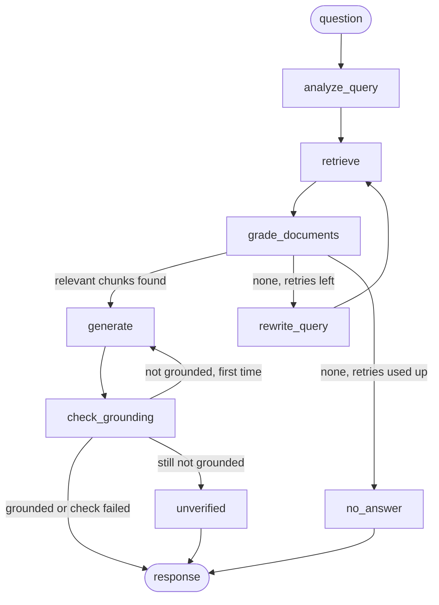

# Docs Assistant

A question-answering service over technical documentation. You ask a question, it retrieves chunks from a local vector store, checks each chunk for relevance, and writes an answer that cites the files it used. If nothing relevant turns up, it rewrites the query and tries again a limited number of times, then says it does not know.

It is built with LangGraph, FastAPI, ChromaDB, local sentence-transformers embeddings and Groq-hosted models. I tested it with `openai/gpt-oss-20b`.

## Corpus

I used five pages of the official FastAPI tutorial: first steps, path parameters, query parameters, request body and dependencies. They are public, written in markdown, and mix concepts with code examples, which is what I wanted to stress the chunker and the citations with. They are also small enough that I can tell by reading whether an answer is right. The pages are committed in `data/corpus/`, and `scripts/fetch_corpus.py` downloads them again from `raw.githubusercontent.com`.

The upstream markdown pulls its code in with include markers, so the fetch script replaces each marker with the real example as a fenced block, drops the `{ #anchor }` heading ids and turns `/// tip` blocks into `**Tip:**`.

## Architecture



With `ENABLE_HALLUCINATION_CHECK=false`, `generate` goes straight to the end and the last two nodes are not added to the graph.

### Nodes

| Node | What it does |
|---|---|
| `analyze_query` | One structured LLM call. Returns a standalone version of the question, a keyword-style search query with synonyms, and the query type (conceptual, how-to, troubleshooting, api-reference). The only node that sees conversation history. |
| `retrieve` | Similarity search on `search_query`, top `TOP_K` chunks. The similarity score is added to each chunk's metadata. |
| `grade_documents` | One structured LLM call per chunk, run with `.batch`, `GRADING_CONCURRENCY` at a time (default 2), each on a chunk shortened to `GRADING_CHUNK_CHARS` characters. Keeps the chunks marked relevant. One call that fails or cannot be parsed counts as irrelevant and is logged. If every call in a round fails, the run ends with a provider error instead of looking like a miss. |
| `rewrite_query` | Asks for a different query, given the standalone question and the query that failed. Increments `retry_count`. |
| `generate` | Answers only from the relevant chunks and cites them inline as `[source: file.md]`. Returns a de-duplicated source list (source, title, header path). On a regeneration it also receives the unsupported claims to avoid. If the call fails, the run ends with a provider error. |
| `check_grounding` | Asks an LLM which claims in the answer the chunks do not support. If the call itself fails it logs a warning and lets the answer through. |
| `unverified` | Returns `no_answer=true` with a message saying the answer could not be verified. |
| `no_answer` | Returns `no_answer=true` with a "could not find this in the indexed documentation" message and no sources. |

### State

`GraphState` is a TypedDict in `app/graph/state.py`; the docstring there lists which node writes each field. The ones that need explaining:

- `question` is set once and never overwritten. It is what the user typed, and it is what gets stored for feedback and conversation history.
- `standalone_question` is the question rewritten so it makes sense without the conversation. It only differs from `question` when there is history; with no history I keep the user's wording instead of trusting a paraphrase. Grading, generation and `rewrite_query` use it, so a follow-up like "what about optional ones?" is judged and answered as a full question. History itself reaches `analyze_query` and nothing else.
- `search_query` is the retrieval string. `analyze_query` sets it and `rewrite_query` replaces it on a retry. I kept it separate from `standalone_question` because it is keyword-heavy and changes between attempts, which makes it a poor thing to grade or answer against.
- `retry_count` starts at 0 and only `rewrite_query` increments it. It goes up even when the rewrite fails or returns the same query, so the loop always ends. The router sends the flow back to `rewrite_query` while `retry_count < max_retries`, so a question gets at most `1 + max_retries` retrievals.
- `regenerate_count` is incremented by `generate` only when it is redoing an answer after a failed grounding check. The router allows one regeneration, so at most two answers are written per question.
- `provider_error` is set when every grading call in a round fails, or when the answer call fails. The graph ends there and `run_graph` raises `ProviderError`, which is how a broken provider stays distinct from "the docs have no answer".
- `grounded` is `True`, `False`, or `None` when the check did not run or its call failed. `None` is treated like `True`.
- `trace` collects the visited node names through a list-concatenating reducer. It is returned by `run_graph` and printed by `scripts/ask.py`.

### Layout

```
app/config.py   app/ingestion/ (loader, chunker, indexer)   app/graph/ (state, nodes, prompts, llm, builder)
app/services/ (query, ingestion, feedback, memory)          app/api/ (main, routes, schemas)
scripts/ (fetch_corpus, ingest, ask, evaluate)   ui.py   data/corpus/   data/eval_questions.json   tests/
```

## Setup

The pinned versions come from a Python 3.13 environment. The code needs 3.11 or newer (it uses `datetime.UTC`); I have run it only on 3.13.

Linux / macOS:

```
python3 -m venv venv
source venv/bin/activate
pip install -r requirements.txt
cp .env.example .env
```

Windows (PowerShell):

```
py -3 -m venv venv
venv\Scripts\Activate.ps1
pip install -r requirements.txt
copy .env.example .env
```

For running the tests and lint, install `requirements-dev.txt` instead (it includes `requirements.txt`). Direct dependencies are pinned to the versions I tested with; transitive ones are left to pip.

Put your key in `.env` as `GROQ_API_KEY=...`, or export it in the shell. Environment variables win over `.env`. Run everything from the repository root: relative paths such as `CHROMA_DIR` are resolved from the directory you start the process in.

| Variable | Default | Meaning |
|---|---|---|
| `GROQ_API_KEY` | empty | Groq API key. Without it the API still starts, but `/query` returns 503. |
| `GENERATION_MODEL` | `openai/gpt-oss-20b` | Writes the answer. |
| `GRADER_MODEL` | `openai/gpt-oss-20b` | Query analysis, chunk grading and query rewriting. |
| `GROUNDING_MODEL` | `openai/gpt-oss-20b` | Checks the answer against the chunks. |
| `EMBEDDING_MODEL` | `sentence-transformers/all-MiniLM-L6-v2` | Local embedding model. |
| `HF_TOKEN` | empty | Optional Hugging Face token. The model is public, so it is not needed; it only raises download limits. |
| `CHROMA_DIR` | `chroma_db` | Where Chroma persists the index. |
| `FEEDBACK_DB` | `data/feedback.sqlite3` | SQLite file for queries and feedback. |
| `TOP_K` | `5` | Chunks retrieved per attempt. |
| `MAX_RETRIES` | `2` | Query rewrites allowed after a failed grading round. |
| `CHUNK_SIZE` | `900` | Target chunk size in characters. |
| `CHUNK_OVERLAP` | `150` | Overlap when a long section is split. |
| `STRUCTURED_OUTPUT_METHOD` | `json_schema` | How structured LLM output is requested: `json_schema`, `function_calling` or `json_mode`. |
| `GRADING_CONCURRENCY` | `2` | Grading calls in flight at once. |
| `GRADING_CHUNK_CHARS` | `1200` | Characters of each chunk sent to the grader. Stored text and citations are not shortened. |
| `EVAL_PAUSE` | `5` | Seconds `scripts/evaluate.py` waits between questions (also `--pause`). |
| `ENABLE_HALLUCINATION_CHECK` | `true` | Adds `check_grounding` after `generate`. |
| `ENABLE_MEMORY` | `true` | Keeps per-session history for follow-up questions. |
| `API_BASE_URL` | `http://localhost:8000` | Where `ui.py` finds the API. |

The model defaults are the ones I tested. Groq accounts differ in which models they may use: with my key `llama-3.1-8b-instant` and `llama-3.3-70b-versatile` came back as 404 `model_not_found`, while `openai/gpt-oss-20b` worked for every step. If your account is refused a model, set `GENERATION_MODEL`, `GRADER_MODEL` and `GROUNDING_MODEL` in `.env` or in the shell; each one is independent, so you can use a larger model for generation only.

**Rate limits.** Groq's free tier has low per-minute limits (about 8,000 tokens per minute per model on the account I used), and one question makes several calls: one per retrieved chunk for grading alone. Every LLM step (analysis, grading, rewrite, generation and the grounding check) retries an HTTP 429 up to 5 times with exponential backoff and jitter, waiting as long as the `retry-after` hint says when the error carries one. Grading also runs only `GRADING_CONCURRENCY` calls at a time and sends each chunk cut to `GRADING_CHUNK_CHARS` characters; generation, the grounding check and the citations keep the full text. On a paid tier you can raise the concurrency. If a model rejects JSON-schema output, set `STRUCTURED_OUTPUT_METHOD=function_calling`.

`ui.py` reads `API_BASE_URL`, `UI_HOST` (default `127.0.0.1`) and `UI_PORT` (default `7860`) from `.env` in the repository root and from the environment. A variable set in the shell wins over the file.

The corpus is already in `data/corpus/`. To download it again, run `python scripts/fetch_corpus.py`; files that already exist are skipped. Then build the index:

```
python scripts/ingest.py
```

The first run downloads the embedding model from Hugging Face (roughly 90 MB). On my run it reported `Ingested 5 documents, 84 chunks`: 18 for `dependencies.md`, 23 for `first-steps.md`, 20 for `path-params.md`, 9 for `query-params.md` and 14 for `request-body.md`.

## Running

API:

```
uvicorn app.api.main:app --port 8000
```

Interactive docs are at `http://localhost:8000/docs`. Start the API before the UI.

Chat UI:

```
python ui.py
```

Open `http://127.0.0.1:7860`. Each browser session gets its own session id, so follow-up questions share history, and the thumbs buttons post to `/feedback` for the last answer. API errors (503, 502, 422, connection refused, timeout) are shown in the chat as a short message.

One question from the command line:

```
python scripts/ask.py "How do I declare an optional query parameter with a default value?"
```

It prints the node trace, query type, final search query, retry count, the answer and the sources.

A real run (captured 2026-10-16, `openai/gpt-oss-20b`). The trace shows `check_grounding` rejecting the first draft, one regeneration, and the second draft passing:

```
trace:        analyze_query -> retrieve -> grade_documents -> generate -> check_grounding -> generate -> check_grounding
query type:   how-to
final query:  FastAPI optional query parameter default value
retries:      0

To make a query parameter optional you give it a default value. The most common way is to set the default to `None`, which tells FastAPI that the parameter is not required:

    @app.get("/items/{item_id}")
    async def read_item(item_id: str, q: str | None = None): ...

In this example the function parameter `q` is a query parameter that is optional and will be `None` when it is not supplied in the request [source: query-params.md | Optional parameters].
...
sources:
  - query-params.md | Query Parameters > Required query parameters
  - query-params.md | Query Parameters > Optional parameters
  - request-body.md | Request Body > Request body + path + query parameters
```

Tests and lint need no network and no API key. The evaluation needs a key and an ingested index:

```
pytest -q
ruff check .
python scripts/evaluate.py   # takes a few minutes, see Evaluation
```

## API

All examples use curl. Requests and responses for `/ingest`, `/documents`, `/feedback` and `/health` below are real: I ran the server without a Groq key and pasted what came back.

### POST /query

```
curl -s -X POST localhost:8000/query -H 'Content-Type: application/json' \
  -d '{"question": "How do I declare an optional query parameter with a default value?", "session_id": "demo-session"}'
```

`question` is 3 to 1000 characters after trimming. `session_id` is optional (1 to 64 characters from letters, digits, `_`, `.` and `-`); reuse it to ask follow-ups. Without one, or with `ENABLE_MEMORY=false`, every question stands alone and `session_id` comes back null.

Response from a live run (captured 2026-10-16, `openai/gpt-oss-20b`; the JSON is shown on several lines for reading, the server returns it on one):

```
{
  "query_id": "1dc987d975b84434a1edade956f6f30e",
  "answer": "To make a query parameter optional you give it a **default value** in the function signature.\nFastAPI sees that the parameter has a default and therefore does not require it in the request URL.\n\n```python\nfrom fastapi import FastAPI\n\napp = FastAPI()\n\n# q is an optional query parameter; it defaults to None\n@app.get(\"/items/{item_id}\")\nasync def read_item(item_id: str, q: str | None = None):\n    if q:\n        return {\"item_id\": item_id, \"q\": q}\n    return {\"item_id\": item_id}\n```\n\n> \"When you declare a default value for non-path parameters ... then it is not required.\"\n> [source: query-params.md | Query Parameters > Required query parameters]\n\n... (answer shortened here)",
  "sources": [
    {"source": "query-params.md", "title": "Query Parameters", "header_path": "Query Parameters > Required query parameters"},
    {"source": "query-params.md", "title": "Query Parameters", "header_path": "Query Parameters > Optional parameters"},
    {"source": "request-body.md", "title": "Request Body", "header_path": "Request Body > Request body + path + query parameters"}
  ],
  "query_type": "how-to",
  "retries": 0,
  "no_answer": false,
  "session_id": "demo-session"
}
```

`no_answer` is true when nothing relevant was found or when the answer could not be verified. In both cases `sources` is empty.

| Status | When |
|---|---|
| 200 | An answer or a "not found" response. |
| 422 | Question outside 3 to 1000 characters, or a bad `session_id`. |
| 502 | The graph raised: every grading call failed, answer generation failed, or something else broke. The detail is logged, the client gets a generic message. |
| 503 | The index is empty, or no `GROQ_API_KEY` is configured. |

Real error responses from the server without a key:

```
{"detail":"The language model is not configured on the server."}                       (503)
{"detail":[{"type":"string_too_short","loc":["body","question"],"msg":"String should have at least 3 characters","input":"hi","ctx":{"min_length":3}}]}   (422)
```

### POST /ingest

Multipart form with `files` (repeatable) and/or `urls` (separated by spaces, commas or newlines, up to 10). Accepted files are `.md`, `.markdown`, `.txt`, `.html` and `.htm`, at most 2 MB each. Ingesting a source that already exists replaces its chunks.

```
curl -s -X POST localhost:8000/ingest -F "files=@notes.md"
{"ingested":[{"source":"notes.md","chunks":3}],"errors":[]}                                  (201)

curl -s -X POST localhost:8000/ingest -F "files=@setup.exe"
{"ingested":[],"errors":[{"source":"setup.exe","reason":"unsupported file type '.exe' (use .md, .txt or .html)"}]}   (400)

curl -s -X POST localhost:8000/ingest -F "urls=https://raw.githubusercontent.com/fastapi/fastapi/master/docs/en/docs/tutorial/cors.md"
{"ingested":[{"source":"https://raw.githubusercontent.com/fastapi/fastapi/master/docs/en/docs/tutorial/cors.md","chunks":10}],"errors":[]}   (201)
```

Each input is validated on its own. If at least one is indexed the status is 201 and the failures are listed under `errors`. If none is, the status comes from the first failure: 400 for a wrong type, an empty file or an unreachable URL, 413 for something over 2 MB. A request with no file and no URL gets 400, and malformed URLs get 422. For a URL the source name is the URL itself.

### GET /documents

This listing was taken after ingesting `notes.md` on top of the corpus.

```
curl -s localhost:8000/documents
[{"source":"dependencies.md","title":"Dependencies","chunk_count":18},{"source":"first-steps.md","title":"First Steps","chunk_count":23},{"source":"notes.md","title":"Deployment notes","chunk_count":3},{"source":"path-params.md","title":"Path Parameters","chunk_count":20},{"source":"query-params.md","title":"Query Parameters","chunk_count":9},{"source":"request-body.md","title":"Request Body","chunk_count":14}]   (200)
```

### POST /feedback

`rating` is `up` or `down`; `comment` is optional, up to 1000 characters. The `query_id` must come from an earlier `/query` response.

```
curl -s -X POST localhost:8000/feedback -H 'Content-Type: application/json' \
  -d '{"query_id":"3f2a9c1e5b7d4a60b8c2d1e0f9a8b7c6","rating":"down","comment":"Missing a code example"}'
{"feedback_id":1,"query_id":"3f2a9c1e5b7d4a60b8c2d1e0f9a8b7c6","rating":"down","comment":"Missing a code example","created_at":"2026-10-15T17:10:01+00:00"}   (201)

curl -s -X POST localhost:8000/feedback -H 'Content-Type: application/json' -d '{"query_id":"does-not-exist","rating":"up"}'
{"detail":"Unknown query_id 'does-not-exist'."}   (404)
```

I captured these without a key, so the id above belongs to a row I inserted into the SQLite file by hand. With a key you get a real one from `/query`. An invalid `rating` or an over-long comment returns 422.

### GET /health

```
curl -s localhost:8000/health
{"status":"ok","graph_ready":false}   (200)
```

`graph_ready` is false here because no key was set. It is true when the graph loaded.

## Design decisions and tradeoffs

**Chunking.** I split on `#`, `##` and `###` headings first, so a section stays together and each chunk carries a header path (`Query Parameters > Defaults`) to cite. Long sections are then cut with LangChain's recursive splitter at 900 characters with 150 of overlap. Fenced code blocks are kept whole unless they are longer than twice the chunk size, in which case they are cut by lines and each part is re-fenced. I wrote the heading split myself because `MarkdownHeaderTextSplitter` strips leading whitespace and flattened the indentation in the Python examples. Neighbouring small pieces are packed into one chunk, and that packing adds no overlap; overlap only exists inside a long split section. Sizes are characters, not tokens.

**Embedding model.** `all-MiniLM-L6-v2` runs locally, needs no key and no network once downloaded, and is fast enough on a CPU for a corpus this size. The cost is quality: it is weaker than larger or hosted embedding models, it is English-centric, and it truncates input at 256 tokens. 900 characters of prose fits; a long code chunk (up to 1800 characters) can be truncated in its embedding. A hosted model would fix that at the price of another API dependency and a cost per ingest. Vectors are normalised and the Chroma collection uses cosine distance.

**Header path in the embedding.** Each chunk is embedded as its header path plus its text, while the stored text and metadata stay unchanged. The reason is that a chunk such as "In this case, there are 3 query parameters" says little without its section name. In the one query I compared, the nearest distances improved but the top-3 order did not change, so I will not claim more than that.

**Chroma.** It runs in-process, persists to a directory and needs no server, which suits a take-home. It is a single-node store, and I write chunks through its underlying collection so the embedded text can differ from the stored text.

**Models.** All three roles (query analysis, grading and rewriting; answer generation; the grounding check) default to `openai/gpt-oss-20b`, because that is the model that worked with my key for every step. They stay three separate settings. A small model for the many short grading calls and a larger one for the answer and the grounding check is the split I would try first, but I have not compared them. All calls use temperature 0, a 30 second timeout and the SDK's two retries. Structured output uses Groq's JSON-schema mode for analysis, grading, rewrite and the grounding check. In function-calling mode `gpt-oss-20b` failed the grounding check with a 400 `tool_use_failed` error (it tried to call a tool that was not in the request), which is why `json_schema` is the default and `function_calling` stays available as a setting.

**Grading cost.** Grading is one call per retrieved chunk, so a retrieval costs `TOP_K` calls, and with the default `MAX_RETRIES=2` a question that exhausts its retries makes `3 * TOP_K` of them. They run `GRADING_CONCURRENCY` at a time (default 2). That keeps me under the free-tier token limit but costs latency: five chunks take about three calls' worth of time instead of one. Each chunk is cut to 1200 characters in the grading prompt only, which trims tokens while the generator still reads the whole chunk. A single call that ranks all chunks would be cheaper, but one malformed output would then lose the whole batch. Per-chunk calls fail one chunk at a time, and a round where all of them fail is reported as a provider error.

**Provider errors.** A model that returns 404, a revoked key or an outage must not look like a question the docs cannot answer. A rate-limited call is retried first (see Rate limits); it only counts as failed once the retries are used up. If every grading call in a round fails (an exception or unparseable output for every chunk), the graph stops, retrying would only repeat the failure, and `run_graph` raises `ProviderError`. The API turns that into a 502 with a generic message, `scripts/ask.py` prints the detail, and the evaluation script records the question as an error. Failed answer generation is handled the same way. The other steps degrade quietly and log a warning: a failed analysis searches with the raw question, a failed rewrite keeps the old query, a failed grounding check lets the answer through.

**Retry loop.** The limit is a counter in state (`MAX_RETRIES`, default 2) that rises on every rewrite, including a failed one. LangGraph's recursion limit is set to `3 * max_retries + 15` as a second guard.

**Grounding check.** It costs one more LLM call per answer. A false positive turns a good answer into "could not verify", which is the safe direction for this kind of tool but can annoy. The check only sees the retrieved chunks, so it cannot catch a chunk that is itself wrong. It is skipped when generation already failed.

**Conversation memory.** A dict from session id to the last 6 turns, with at most 1000 sessions and least-recently-used eviction, behind a lock. It is lost on restart and not shared between processes. That is a deliberate simplification. Answers are cut to 600 characters when they go into the analyzer prompt.

**SQLite.** Feedback and every answered query go into one SQLite file using the standard library. I store the queries so that a `query_id` handed out before a restart still accepts feedback. Each call opens its own connection because endpoints run in worker threads. Feedback is append-only, so one query can collect several ratings.

**URL ingestion.** Fetching a user-supplied URL from the server is a request-forgery risk, so only http and https are allowed, the host is resolved and anything that is not a public address is refused, and the check runs again on every redirect. A declared `Content-Length` over 2 MB is rejected. It does not protect against DNS rebinding between the check and the connection, and a server that sends no `Content-Length` is only checked after the download.

**503 without a key.** The app starts without `GROQ_API_KEY` so ingestion, listing and feedback keep working, and `/query` answers 503. I wanted "the server is not configured" to look different from 502, which means something broke while answering.

## Evaluation

`scripts/evaluate.py` reads `data/eval_questions.json`, runs each question through `run_graph`, and prints one row per question: expected and actual outcome, retries, sources, whether the expected source file was among them, and latency. It writes the full records (answer, trace, query type, grounding result, any error) plus a summary to `eval_results.json`, and ends with a line like `correct routing x/10, expected source found y/7`.

The script waits `EVAL_PAUSE` seconds between questions (default 5, or `--pause N`) so the per-minute token window can recover. With the pauses, the retries and several LLM calls per question, a run takes a few minutes on the free tier. `eval_results.json` is rewritten after every question, with `"complete": false` until the last one, so stopping the script with Ctrl-C keeps what finished. Progress lines go to stderr.

The set has 10 questions. Seven are answerable from the corpus, each with the file that should be cited: two on query parameters, two on first steps, and one each on path parameters, request body and dependencies. Three are clearly out of scope (a PyTorch CNN, a Kubernetes ingress, the capital of Australia) and should end in `no_answer`.

"Correct routing" means the graph answered when it should have and declined when it should have. "Expected source found" only counts for the seven answerable questions. A question that raises an error, including a provider error such as a refused model or a rate limit that survived the retries, is recorded with the error text and the run continues. The script exits with a message if `GROQ_API_KEY` is unset or the index is empty. This checks routing and retrieval, not the quality of the answer text, and ten questions is a small sample.

### Results

Run of 2026-10-16 with `openai/gpt-oss-20b` for every step (full records in `eval_results.json`): **correct routing 10/10, expected source found 7/7, 0 errors, average latency 42.8 s** (the 5 s pause between questions is not counted).

| # | Question | Expected | Actual | Retries | Sources | Latency |
|---|---|---|---|---|---|---|
| 1 | Optional query parameter with a default value | answer | answer | 0 | query-params.md, request-body.md | 8.5s |
| 2 | Make a query parameter required | answer | answer | 0 | query-params.md, request-body.md | 24.1s |
| 3 | Start the FastAPI development server | answer | answer | 0 | first-steps.md | 37.1s |
| 4 | What is a path operation decorator | answer | answer | 0 | dependencies.md, first-steps.md | 58.2s |
| 5 | Restrict a path parameter to fixed values | answer | answer | 0 | path-params.md | 63.8s |
| 6 | JSON request body with a Pydantic model | answer | answer | 0 | request-body.md | 40.3s |
| 7 | What is dependency injection in FastAPI | answer | answer | 0 | dependencies.md | 45.1s |
| 8 | Train a CNN in PyTorch | no_answer | no_answer | 2 | - | 45.2s |
| 9 | Kubernetes ingress with TLS | no_answer | no_answer | 2 | - | 50.5s |
| 10 | Capital of Australia | no_answer | no_answer | 2 | - | 55.5s |

Latency is dominated by free-tier rate-limit waits, not compute. The three out-of-scope questions each used both retries before giving up, as designed.

## Assumptions, limitations and next steps

Assumptions: the documents are English markdown, text or simple HTML; the API is used by trusted clients on one machine; one server process; the Groq key can use the three configured models.

Known limitations:

- No authentication and no rate limiting on the API.
- Some LLM failures are absorbed on purpose (analysis, rewrite, grounding check, a single grading call), so the user gets a normal response and only the log shows the problem.
- Ingested markdown only has `{ #anchor }` removed from headings. Other MkDocs syntax, such as include markers and `///` admonitions, is cleaned by `fetch_corpus.py` only. Documents ingested before the anchor cleanup keep their old titles until they are ingested again.
- HTML is reduced to plain text, so tables and code layout are lost. There is no PDF support.
- There is no endpoint to delete a document, and two concurrent ingests of the same source can interleave.
- `query_type` is returned but does not change retrieval or prompting yet.
- Feedback is stored but nothing reads it.

What I would do with more time:

- Hybrid retrieval: BM25 alongside vectors, merged with reciprocal rank fusion, which should help exact identifiers such as parameter names.
- A cross-encoder reranker over a wider candidate set, so fewer chunks need LLM grading.
- Streaming the answer.
- Authentication and per-client rate limits.
- Sessions in SQLite or Redis so they survive restarts and multiple workers.
- A larger evaluation set with checks on the answer text, not only routing and sources.
- Caching of query analysis and of answers to repeated questions.
- A shared token budget or queue. The retry and concurrency limits apply per request, so several simultaneous `/query` calls can still exceed a per-minute limit together.
- Token-based chunk sizes, so code chunks match the embedding model's window.